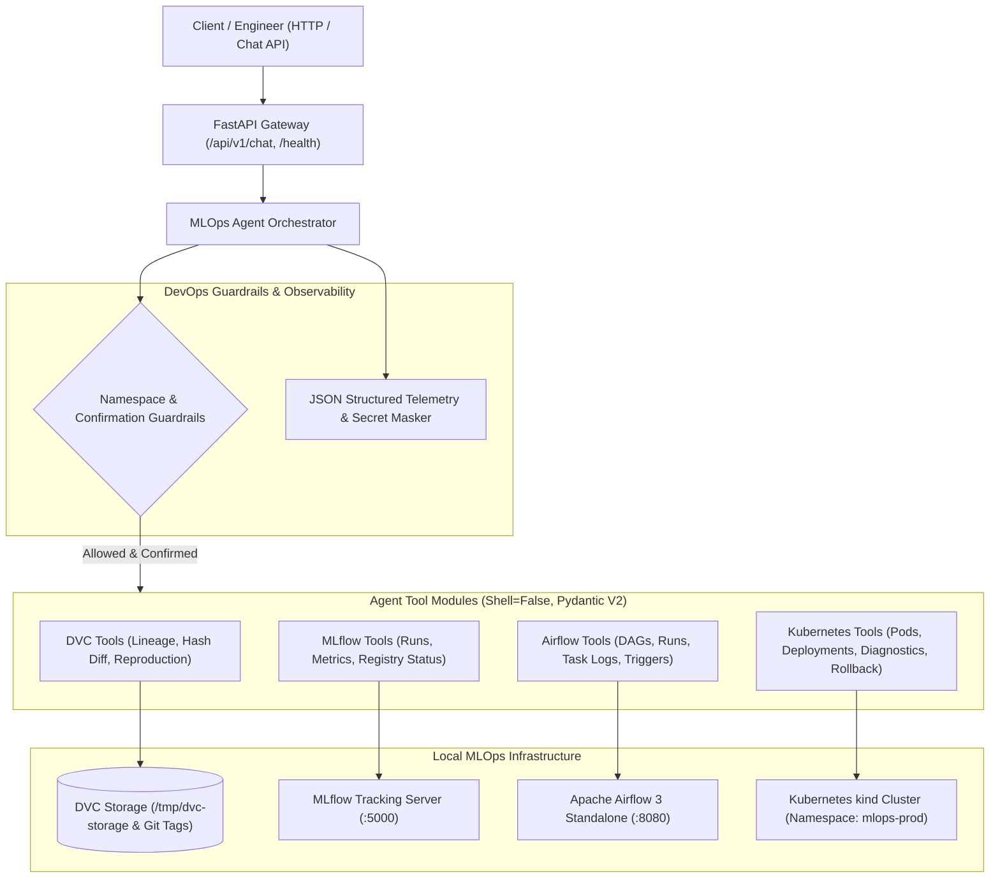
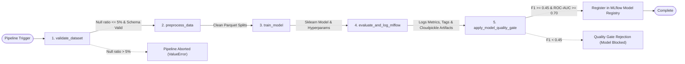
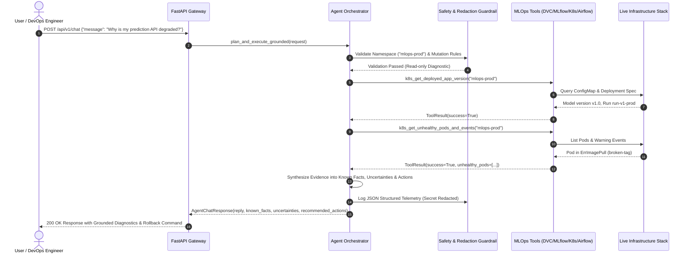

# MLOps AI Agent System Architecture

## 1. High-Level System Architecture

The following diagram illustrates the interaction between the User/Client, the FastAPI Gateway, the Multi-Tool LLM Orchestrator, and the four integrated infrastructure backends: **DVC**, **MLflow**, **Apache Airflow 3**, and **Kubernetes (`kind`)**.

---

## 2. Airflow 3 5-Stage Training Pipeline Architecture

The model training pipeline is implemented using the Apache Airflow 3 TaskFlow API. It guarantees data quality, pre-processing consistency, MLflow lineage tracking, and automated quality gate enforcement before registering models in the MLflow Model Registry.

### Pipeline Stage Details:
1. **`validate_dataset`**: Inspects `data/dataset.csv`. Verifies all required columns exist (`customer_id`, `tenure_months`, `monthly_charges`, `total_charges`, `contract_type`, etc.) and ensures missing value ratio is $\le 5\%$.
2. **`preprocess_data`**: Implements stratified 80/20 train/test splitting, one-hot encodes categorical features, scales numeric values, and stores clean partitions into `data/train.parquet` and `data/test.parquet`.
3. **`train_model`**: Trains a Scikit-Learn `RandomForestClassifier` parameterized via `params.yaml`.
4. **`evaluate_and_log_mlflow`**: Computes evaluation metrics ($F_1$, precision, recall, ROC-AUC) and logs Git commit hash, dataset Git tag, and DVC MD5 data hash as searchable MLflow tags.
5. **`apply_model_quality_gate`**: Compares candidate model $F_1$ score against `params.yaml:quality_gate.min_f1`. Only approved models are promoted to `CustomerChurnClassifier` in the MLflow Model Registry.

---

## 3. Grounded Multi-Tool Reasoning & Guardrail Execution Sequence

The agent enforces zero-hallucination policies and strict state mutation safeguards. State-mutating commands (e.g., triggering workflows or restarting Kubernetes deployments) are rejected if `user_confirmed` is not `True` or if targeting outside `mlops-prod`.

---

## 4. Security & Safety Model

1. **Subprocess Isolation**: Zero instances of `shell=True`. All shell binaries (`git`, `dvc`, `kubectl`) are invoked via explicit, sanitized argument lists.
2. **Namespace Guardrail**: Only the `mlops-prod` namespace is accessible for write operations. Any request targeting `kube-system`, `default`, or other namespaces fails immediately with a security rejection.
3. **Double Confirmation**: Workflows mutating state (`restart_deployment`, `trigger_training_dag`) require `user_confirmed=True`.
4. **Data Redaction**: Telemetry engine uses regex patterns to filter Bearer JWT tokens, API keys (`sk-...`), and passwords before emitting JSON logs.
